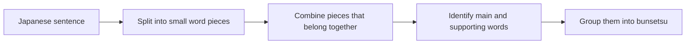

# How Fushi Creates Bunsetsu

## What is a bunsetsu?

A **bunsetsu** (文節) is a small meaningful section of a Japanese sentence.

For example, this sentence:

> 私は本を読む。

can be divided into:

> **私は｜本を｜読む。**

Each section contains a main word. Small words that support it, such as **は** and **を**, stay with that main word.

Fushi creates these sections automatically.

## The basic idea

Imagine placing the words of a sentence into boxes:

1. Open a new box when you find a **main word**.
2. Put the following **supporting words** into the same box.
3. Open another box when the next main word appears.

That is essentially how Fushi creates bunsetsu.

For **私は本を読む**, Fushi treats the words like this:

| Word | Role | What happens |
| --- | --- | --- |
| 私 | Main word | Starts the first section |
| は | Supporting word | Joins 私 |
| 本 | Main word | Starts the second section |
| を | Supporting word | Joins 本 |
| 読む | Main word | Starts the third section |

The result is:

> **私は｜本を｜読む**

## From a sentence to bunsetsu

Fushi does not do everything in one step. It uses several stages:

### 1. Split the sentence into word pieces

A language tool called **kuromoji** first divides the sentence into small pieces and supplies information about each piece, such as its part of speech.

For example:

> 私は本を読まない。

may initially be divided into pieces similar to:

> 私｜は｜本｜を｜読ま｜ない

Kuromoji performs this first analysis. Fushi then interprets the pieces using Japanese School Grammar.

### 2. Combine pieces that belong together

Sometimes several small pieces should be treated as one grammatical word.

For example, Fushi can combine:

- An adjectival noun stem and its ending, such as **静か + だ**.
- A prefix or suffix and its main word.
- The parts of **そうだ** when appropriate.

This prevents Fushi from splitting a grammatical word into separate bunsetsu merely because kuromoji originally supplied several pieces.

Fushi also remembers the original pieces and where they appeared in the sentence.

### 3. Identify main and supporting words

Fushi labels each grammatical word as either **independent** or **dependent**.

These terms describe the role of a word when forming bunsetsu:

- An **independent word** can begin a bunsetsu. It is the “main word” in the box analogy.
- A **dependent word** normally follows and supports a main word. It does not begin a new bunsetsu.

Common independent words include:

- Nouns, such as **私** and **本**.
- Verbs, such as **読む**.
- Adjectives.
- Adjectival nouns.
- Adverbs and several other word types.

Common dependent words include:

- Particles, such as **は**, **を**, and **に**.
- Auxiliary verbs, such as **ない** when it attaches to a verb.

A word's role can depend on its context. For example, **ない** can behave differently in different sentences. Fushi checks nearby words before deciding how to treat it.

### 4. Group the words

Fushi reads the grammatical words from left to right:

- When it reaches an independent word, it starts a new bunsetsu.
- When it reaches a dependent word, it adds that word to the current bunsetsu.

For **私は本を読まない**, this produces:

> **私は｜本を｜読まない**

Here, **読ま** begins the final section and **ない** stays with it.

## What happens in unusual cases?

Fushi tries to preserve the input rather than discard words it cannot handle.

If a sentence begins with a dependent word, Fushi keeps it in an initial bunsetsu and records a warning. A warning explains that the result may need attention; it does not mean the word was removed.

Fushi can also record warnings when it encounters an unfamiliar word type or cannot determine a grammatical distinction confidently.

## What Fushi does not do

Fushi's bunsetsu grouping follows clear rules. It does not use artificial intelligence to understand the meaning of the whole sentence.

Fushi can identify **some basic grammatical relationships** between bunsetsu. For example, given:

> **私は｜本を｜読む**

it can label **私は** as the subject, **本を** as a modifier, and **読む** as the predicate. It can also record that **私は** is the subject of **読む** and that **本を** modifies **読む**. For some sentences, it can recognize connective, relative, and coordinate clauses as well. These sentence-level results are experimental; the sandbox shows 単語・文節 first and puts sentence analysis in a collapsed section.

For selected `[動詞＋て／で]＋[補助動詞]` patterns, Fushi can also form a **combined phrase segment（連文節）** with a **subsidiary relation（補助の関係）**. For example, `降って｜いるので` remain two 文節 but together form `降っているので`. In a **connective clause（接続節）**, that expression has an internal predicate but functions as a **connective（接続語）** at sentence level. The grouped representation keeps those levels separate.

However, this is **best-effort analysis, not a complete grammatical tree or a full understanding of the sentence**. Fushi does not guess omitted or shared subjects, unclear modifier targets, or unsupported clause boundaries. Standalone temporal nouns marked `副詞可能` and purpose expressions such as `見に` before supported motion predicates are recognized as **連用修飾語**. A recognizable modifier can retain its **修飾語** component and **連体修飾語／連用修飾語** subtype even when its target is undetermined; Fushi then records a warning without creating a relationship. Quotation and complement clauses, nested relative clauses, general phrase-segment combination (**連文節**) beyond explicit subsidiary relations, general 主語節・述語節・連用修飾節 recognition, and unrestricted semantic relationships remain outside its analysis.

When Fushi cannot determine a role or relationship confidently, it leaves that information out and records a warning. A missing label or relationship therefore does not prove that none exists.

The quality of the result depends on:

1. Kuromoji's initial division of the sentence.
2. Fushi's rules for combining word pieces.
3. Fushi's decisions about which words are independent or dependent.
4. Whether the sentence contains relationships and clause structures that Fushi supports.

## In one sentence

**Fushi creates a bunsetsu by starting with a main word and attaching the supporting words that follow it, stopping when the next main word appears.**
