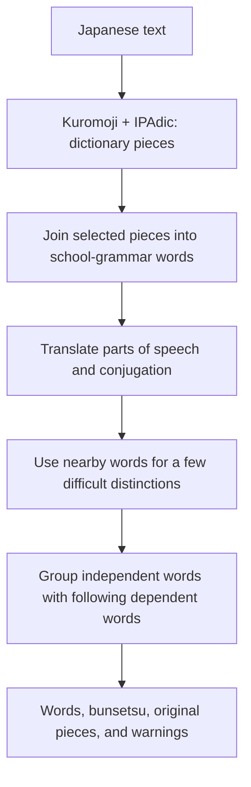

# From IPAdic to Japanese School Grammar

A plain-English guide to how Fushi translates Japanese dictionary information into **school grammar（学校文法）**—and where that translation is incomplete or incorrect.

**No programming knowledge is needed for the main explanation.** The later sections contain a detailed audit for maintainers.

> **Most important point:** Fushi's result is a best-effort grammatical interpretation, not an authoritative answer. **No warning does not mean no mistake.** Unsupported, ambiguous, and out-of-scope cases remain.

## 1. The basic idea

Japanese text passes through two different systems:

1. **Kuromoji with IPAdic** divides text into small pieces and supplies dictionary labels.
2. **Fushi** reorganizes those pieces into school-grammar words, adds conjugation information, and groups words into phrase segments called **文節（bunsetsu）**.

These systems do not use exactly the same units or labels. Fushi therefore cannot simply copy IPAdic's answers.

### A small example

For:

> 私は静かな本を読まない。

IPAdic supplies pieces similar to:

> 私｜は｜静か｜な｜本｜を｜読ま｜ない｜。

Fushi produces these words:

> 私｜は｜静かな｜本｜を｜読ま｜ない｜。

It then groups them as:

> **私は｜静かな｜本を｜読まない｜。**

The important change is **静か + な → 静かな**. School grammar treats this as one inflecting word: the **attributive form（連体形）** of **静かだ**.

| Word | School-grammar interpretation |
| --- | --- |
| 私 | Noun（名詞） |
| は | Particle（助詞）; more specifically, a topic/binding particle（係助詞） |
| 静かな | Adjectival verb（形容動詞）, attributive form（連体形）; dictionary form 静かだ |
| 本 | Noun（名詞） |
| を | Case particle（格助詞） |
| 読ま | Verb（動詞）, five-grade conjugation（五段）, irrealis form（未然形） |
| ない | Auxiliary verb（助動詞） expressing negation（打消） |
| 。 | Fushi's extra `記号` category; this is **not** one of the ten school-grammar parts of speech |

Fushi also remembers every original dictionary piece and its position in the source text.

## 2. Four ideas that make the translation easier to understand

### 2.1 A dictionary piece is not always a school-grammar word

A **morpheme（形態素）** is a small meaningful piece found by a morphological analyzer. A **word（単語）** in school grammar can contain several such pieces.

Examples:

- **静か + な → 静かな**, one adjectival verb.
- **お + 菓子 → お菓子**, one noun.
- **子ども + たち → 子どもたち**, one noun.
- **そう + だ → そうだ**, one auxiliary verb in supported cases.

Fushi performs the reverse operation in other situations. It keeps **読ま** and **ない** as separate words: a verb followed by an auxiliary verb.

### 2.2 School grammar uses ten parts of speech

The ten are:

| Group | Parts of speech |
| --- | --- |
| Independent and inflecting（自立語・活用あり） | 動詞・形容詞・形容動詞 |
| Independent and not inflecting（自立語・活用なし） | 名詞・副詞・連体詞・接続詞・感動詞 |
| Dependent and inflecting（付属語・活用あり） | 助動詞 |
| Dependent and not inflecting（付属語・活用なし） | 助詞 |

**Independent（自立）** means that a word can begin a bunsetsu. **Dependent（付属）** means that it normally follows an independent word.

Fushi additionally outputs `記号` for punctuation and symbols. This is a practical output category, not an eleventh school-grammar part of speech.

### 2.3 A word's form can depend on its neighbors

Modern school grammar uses six conjugated forms:

| Form | Simple question | Example |
| --- | --- | --- |
| 未然形 | Does it connect to forms such as ない or う? | 読まない、読もう |
| 連用形 | Does it connect to ます, た, て, or another predicate? | 読みます、読んだ、読んで |
| 終止形 | Does it end a predicate or sentence? | 本を読む。 |
| 連体形 | Does it modify a noun or connect to forms such as ので? | 読む本、読むので |
| 仮定形 | Does it connect to ば? | 読めば |
| 命令形 | Does it express a command? | 読め |

IPAdic's **基本形** literally means “basic form.” It does not by itself distinguish **終止形** from **連体形**. Fushi therefore looks at the next word.

### 2.4 A dictionary label is not always a meaning

For example, IPAdic can identify **れる・られる** as an auxiliary verb, but its label does not say whether a particular sentence expresses:

- passive（受身）,
- spontaneous occurrence（自発）,
- possibility（可能）, or
- respect（尊敬）.

Those meanings require interpretation beyond a simple label lookup.

## 3. How Fushi performs the translation

### Step 1: Read the dictionary information

For each piece, IPAdic can provide:

- the text as written;
- its base or dictionary form;
- its reading;
- a part-of-speech label and more detailed labels;
- a conjugation type; and
- a conjugated form.

Fushi copies this information into its own input format. It does not improve the original tokenization at this stage.

### Step 2: Reconstruct selected school-grammar words

Fushi currently recognizes these combinations:

| Combination | Result | Example |
| --- | --- | --- |
| Adjectival stem + one permitted ending | 形容動詞 | 静か + だ、静か + な、静か + に |
| そう or よう + one permitted ending | 助動詞 | そう + だ、そう + です、よう + な |
| サ変接続 noun + immediately adjacent する | One サ変 動詞 | 勉強 + する |
| 同じ + an inflecting だ ending | 形容動詞 | 同じ + だ |
| Prefix + suitable independent host | Usually one word | お + 菓子 |
| Suffix + suitable independent host | Noun, adjectival stem, or verb according to the suffix | 子ども + たち、科学 + 的、痛 + がる |

The permitted adjectival endings are **だ・だろ・だっ・で・に・な・なら**, with **です** handled as a polite terminal ending for reconstructed adjectival and auxiliary-stem words. **勉強をする** remains separate because を interrupts the noun–する sequence. **同じな** remains attributive 連体詞 usage rather than being forced into the inflecting pattern.

This joining stage is intentionally rule-based. It uses IPAdic labels and immediate neighbors; it does not infer arbitrary word boundaries from spelling alone.

### Step 3: Translate the part of speech

Most familiar labels pass through directly:

| IPAdic information | Fushi's usual interpretation |
| --- | --- |
| 動詞 | 動詞; `非自立` adds the subtype 補助動詞 |
| 形容詞 | 形容詞; `非自立` adds the subtype 補助形容詞 |
| 名詞 | 名詞; `非自立` adds the subtype 形式名詞 |
| 副詞 | 副詞 |
| 連体詞 | 連体詞 |
| 接続詞 | 接続詞 |
| 感動詞 | 感動詞 |
| 助動詞 | 助動詞 |
| 助詞 | 助詞; most detailed particle labels are copied |
| フィラー | Usually 感動詞 |
| 記号 | Fushi's extra `記号` category |
| その他 | **Unhandled:** guessed to be noun-like, with a warning |

IPAdic does not need a top-level `形容動詞` label for the common case. Fushi derives it from **名詞・形容動詞語幹** plus a permitted ending.

An unsupported top-level category is not discarded. It is retained as a noun-like token with `MODERN_POS_UNSUPPORTED`. This preserves the text but is only a fallback, not a valid grammatical conclusion.

### Step 4: Translate conjugation

The main type translations are:

| IPAdic label family | Fushi label |
| --- | --- |
| 五段・… | 五段 |
| 一段, or a label beginning 一段・ | 上一段 or 下一段, chosen using a finite word list |
| サ変・… | サ変 |
| カ変・… | カ変 |
| 形容詞・… | 形容詞 |
| 特殊・ダ・デス・マス・タイ・タ・ナイ・ヌ・ラシイ | The same dictionary-style label |
| 文語・ベシ | The same Classical-Japanese label |
| 不変化型 | その他 |
| Any other type | その他, with an unsupported-type warning on a conjugable word |

The one-grade decision uses a finite lexical list of common 上一段 verbs; other IPAdic `一段` entries default to 下一段. Readings disambiguate the exceptional 上一段 spellings 経る（フル） and 獲る（ウル） from their common 下一段 readings. This finite list is not a complete lexical database.

The main form translations are:

| IPAdic form | School-grammar form |
| --- | --- |
| 未然形、未然ウ接続、未然形サ・セ・シ | 未然形 |
| 連用形、連用タ接続、連用テ接続、連用ニ接続、連用ゴザイ接続 | 連用形 |
| 基本形 | Provisionally 終止形, then checked against context |
| 体言接続、体言接続特殊・特殊２ | 連体形, with a limited sentence-final check |
| 仮定形、仮定縮約１・２ | 仮定形 |
| 命令形、命令ｅ・ｉ・ｒｏ・ｙｏ | 命令形 |
| Any other form | No form, plus a warning on a conjugable word |

### Step 5: Apply a small set of contextual rules

Fushi has special handling for a few easily confused words:

| Word or pattern | Intended distinction |
| --- | --- |
| ない | Negative auxiliary after a verb vs. subsidiary adjective after an adjective |
| そうだ | Appearance（様態） vs. hearsay（伝聞） |
| れる・られる | Retains all four possible meanings because one cannot safely be selected |
| の | 格助詞・準体助詞・終助詞, using selected IPAdic labels |
| に | Usually retains its label; some cases become 接続助詞 |
| あの | 連体詞 before nominal material vs. 感動詞 as a hesitation |
| 基本形 | 終止形 vs. 連体形, based mainly on what follows |

These rules cover only selected patterns. They are not a complete understanding of the sentence.

### Step 6: Form bunsetsu

The grouping rule is simple:

1. Start a new bunsetsu at an independent word.
2. Attach following dependent words to it.
3. Repeat at the next independent word.

Thus:

> 私｜は｜本｜を｜読ま｜ない

becomes:

> **私は｜本を｜読まない**

A subsidiary verb such as **いる** in **食べている** remains an independent verb, so it starts its own bunsetsu:

> **食べて｜いる**

If the sequence starts with a dependent word, Fushi retains it and reports `MODERN_BUNSETSU_LEADING_DEPENDENT`.

### Step 7: Preserve the original evidence

A final Fushi word can retain all dictionary pieces from which it was made. This allows a reader or application to compare the school-grammar interpretation with the original IPAdic analysis.

Nothing in this preservation step proves that the interpretation is correct.

## 4. What warnings mean

A **warning** says that part of the result needs attention. It does not usually mean that text was removed.

| Diagnostic | Plain meaning |
| --- | --- |
| `MODERN_POS_UNSUPPORTED` | The part of speech was not recognized; a noun-like guess was retained. |
| `MODERN_KATSUYOU_TYPE_UNSUPPORTED` | The conjugation type was not recognized; `その他` was used, including on auxiliary verbs. |
| `MODERN_KATSUYOU_FORM_UNSUPPORTED` | The conjugated form was not recognized; no form was supplied. |
| `MODERN_RERU_AMBIGUOUS` | Fushi did not choose among passive, spontaneous, potential, and honorific meanings. |
| `MODERN_SOU_AMBIGUOUS` | Fushi could not distinguish appearance from hearsay. |
| `MODERN_NORMALIZE_ORPHAN_PREFIX` | A prefix could not be joined to a suitable host; it is preserved as dependent `接頭詞`. |
| `MODERN_NORMALIZE_ORPHAN_SUFFIX` | A suffix could not be joined to a suitable host; it is preserved as dependent `接尾詞`. |
| `MODERN_BUNSETSU_LEADING_DEPENDENT` | A dependent word appeared without a preceding independent word. |

Input validation can also report malformed pieces or inconsistent source positions. Those warnings concern the supplied data rather than school-grammar coverage.

**The inverse is not safe:** a clean warning list can still contain incorrect parts of speech, word divisions, base forms, or conjugation labels.

## 5. Audit scope and status

The audit below describes the **current working-tree implementation** checked with the locally installed **kuromoji 0.1.2 / mecab-ipadic-2.7.0-20070801** dictionary.

- Real kuromoji/IPAdic examples were run through the current normalization and remapping pipeline.
- All distinct grammar labels in the installed dictionary were inventoried.
- “Confirmed” means that the current output was observed, not merely inferred from a test fixture.
- Expected labels use the school-grammar model described in this repository. Some fine particle terminology differs among textbooks; those cases are marked as framework-dependent.
- Classical Japanese, dialectal entries, and sentence-level analysis must not be confused with missing support for ordinary Modern Japanese.

## 6. Output that does not match normal school-grammar terminology

These are not all programming failures. Some are deliberate placeholders or differences in framework, but readers should not mistake them for standard school-grammar labels.

| Output | Issue |
| --- | --- |
| `記号` as an independent word and its own bunsetsu | `記号` is outside the ten parts of speech. Treating punctuation as an independent bunsetsu is an output convention, not the strict school-grammar model of one independent word plus following dependent words. |
| `その他` as a conjugation type | A placeholder meaning “other,” not a school-grammar conjugation pattern. It is used for reconstructed 形容動詞 and そうだ as well as unsupported types. |
| `特殊・ダ`, `特殊・マス`, `特殊・ナイ`, etc. | IPAdic technical family names are exposed directly; these are not normalized school-textbook conjugation-pattern names. |
| `文語・ベシ` in the modern type list | A Classical-Japanese label, not a Modern Japanese school-grammar conjugation type. |
| `受身・自発・可能・尊敬` | Four possible meanings combined into one subtype, rather than one school-grammar interpretation. A warning is emitted. |
| `様態・伝聞不明` | An unresolved placeholder, not a meaning classification. A warning is emitted. |
| `副助詞／並立助詞／終助詞` | For か, Fushi selects 副助詞 in 誰か来た, 終助詞 for a sentence-final question, and 並立助詞 for a clear coordinated alternative. Other ambiguous compound labels may remain. |
| `接頭詞` / `接尾詞` for orphan affixes | Explicit preservation labels used with warnings when no valid host can be reconstructed. They are dependent fallbacks outside the ten school-grammar parts of speech and do not start a new bunsetsu. |

Most auxiliary verbs also lack a school-grammar meaning label. For example, the generic mapping does not identify **せる＝使役**, **た＝過去・完了**, **ます＝丁寧**, or **う・よう＝意志・推量**. Their word type and conjugation information can still be present; this is missing meaning detail rather than necessarily an incorrect part of speech.

## 7. Complete uncovered-label inventory

These counts describe labels present in the installed dictionary, **not their frequency in everyday text**. The `*` marker means “not applicable” and is excluded.

### 7.1 Top-level part of speech

The dictionary has **13 top-level labels**. Twelve have a direct mapping path, including Fushi's extra `記号` category.

The uncovered top-level label is:

- **その他**, with the detailed category **間投** in this dictionary.

It falls back to a noun-like token with `MODERN_POS_UNSUPPORTED` when supplied to the modern parser. Classical/dialect material and unusual tokenization should be evaluated separately.

### 7.2 Conjugation types

The dictionary has **57 non-`*` conjugation-type labels**. **23** have no explicit mapping:

| Group | Uncovered labels |
| --- | --- |
| Special or dialectal auxiliaries | 特殊・ジャ、特殊・ヤ |
| Classical auxiliaries | 文語・キ、文語・ケリ、文語・ゴトシ、文語・マジ、文語・ナリ、文語・リ、文語・ル、下二・タ行 |
| Classical verb patterns | ラ変、四段・サ行、四段・タ行、四段・ハ行、四段・バ行、上二・ダ行、上二・ハ行、下二・カ行、下二・ガ行、下二・ダ行、下二・ハ行、下二・マ行、下二・得 |

For a final 動詞, 形容詞, or 助動詞, an uncovered type becomes `その他` with `MODERN_KATSUYOU_TYPE_UNSUPPORTED`. If an earlier reconstruction gives the token another part of speech, the warning is skipped.

**Not all 23 are defects in a Modern Japanese parser.** Many belong to Classical Japanese. The real issue is that the system does not clearly separate “outside modern scope” from “unhandled modern form,” and it substitutes a generic label instead of retaining the meaningful original type.

### 7.3 Conjugated forms

The dictionary has **27 non-`*` conjugated-form labels**. **Nine** have no mapping:

| Uncovered form | Plain significance |
| --- | --- |
| 文語基本形 | Classical basic form |
| 未然ヌ接続 | Irrealis before ぬ |
| ガル接続 | A stem/connecting form used before がる and also seen in other adjective-derived constructions |
| 音便基本形 | Phonetically altered basic form |
| 未然特殊 | Special irrealis form |
| 連用デ接続 | Continuative before で |
| 未然レル接続 | Irrealis before れる |
| 基本形-促音便 | Basic form with a sokuon/assimilated-sound variant |
| 現代基本形 | Modern basic form attached to an otherwise Classical pattern |

On a word whose final school-grammar part of speech is 動詞, 形容詞, or 助動詞, these produce no school-grammar form and `MODERN_KATSUYOU_FORM_UNSUPPORTED`. If an earlier reconstruction error gives the token another part of speech, the warning is skipped.

Two ordinary modern examples were confirmed:

| Input | Current effect |
| --- | --- |
| 泣かないで | ない has no conjugated form; `MODERN_KATSUYOU_FORM_UNSUPPORTED` is emitted. |
| おいしそうだ | おいし has no conjugated form because IPAdic supplied ガル接続; a warning is emitted. |

The remaining inventory entries still need representative modern/classical evaluation before being assigned an expected school-grammar label.

## 8. Inherent ambiguity and upstream errors

Not every wrong answer is caused by the remapping tables.

### Ambiguity inside Japanese

The same spelling can have several grammatical meanings. **れる・られる** is the clearest example. Fushi deliberately reports ambiguity rather than guessing.

### Wrong IPAdic analysis

Kuromoji can select the wrong pieces or labels before Fushi starts. Fushi inherits those decisions. A remapping rule cannot reliably recover from every upstream segmentation mistake.

Unknown and unsupported words deliberately retain the noun-like fallback and `MODERN_POS_UNSUPPORTED` warning. Fushi does **not** guess 動詞 merely because an unknown word ends in る or a り+ます-like sequence: those endings are not reliable enough evidence, and noun-like preservation is safer than inventing conjugation information.

### Hand-written fixtures can differ from the real dictionary

A fixture can describe an idealized token sequence that kuromoji never produces. The real **赤いの** analysis differs from the fixture, and real adjective stems can use **ガル接続** where fixtures use another continuative label.

Consequently, unit-test coverage is not evidence of complete real-dictionary coverage.

## 9. Deliberately out of scope

The supported modern pipeline stops at words and ordinary bunsetsu. It does **not** generate:

- sentence components（文の成分）;
- dependency targets（係り受け）;
- clauses（節）;
- sentence types（単文・複文・重文）; or
- combined phrase segments（連文節）.

These are scope boundaries, not missing IPAdic label mappings.

The supported modern pipeline also should not be expected to provide a complete Classical Japanese analysis merely because IPAdic contains Classical entries.

## 10. Remaining limitations and priorities

1. **Broaden lexical verification.** The finite 上一段 list should be checked against a more complete lexical source, including reading/spelling variants.
2. **Map real modern forms.** Start with 連用デ接続 and ガル接続, using a corpus to establish their actual contexts rather than copying the name mechanically.
3. **Review remaining unsupported and ambiguous results.** Avoid presenting noun, `その他`, or a combined meaning label as though it were a completed school-grammar analysis.
4. **Extend the real-IPAdic golden set.** Further claims should include expected words, subtypes, base forms, conjugation types/forms, bunsetsu, and diagnostics.

A good acceptance rule for future work remains:

> **Every claim of school-grammar support should be tested through the same real dictionary path that users actually run.**

## 11. Evidence and references

### Implementation inspected

- [Word reconstruction](./packages/core/src/modern/normalize.ts)
- [Part-of-speech and conjugation remapping](./packages/core/src/modern/remap.ts)
- [Bunsetsu grouping](./packages/core/src/modern/bunsetsu.ts)
- [IPAdic input adapter](./packages/engine-kuromoji/src/ipadic-adapter.ts)
- [Modern hand-written fixtures](./packages/core/tests/modern/fixtures.ts)
- [Real-dictionary integration tests](./packages/engine-kuromoji/tests/real-dictionary.test.ts)
- [Project school-grammar specification](./.plans/gakko_bunpo_agent_spec.md)

### External grammar and dictionary references

- [MeCab IPAdic source dictionary directory](https://github.com/taku910/mecab/tree/master/mecab-ipadic)
- [文部科学省: 中学校学習指導要領解説](https://www.mext.go.jp/a_menu/shotou/new-cs/1387016.htm)
- [口語文法: 下一段活用](https://www.kokugobunpou.com/%E7%94%A8%E8%A8%80/%E5%8B%95%E8%A9%9E-6-%E4%B8%8B%E4%B8%80%E6%AE%B5%E6%B4%BB%E7%94%A8/)
- [口語文法: 助動詞「ようだ」](https://www.kokugobunpou.com/%E5%8A%A9%E5%8B%95%E8%A9%9E/%E3%82%88%E3%81%86%E3%81%A0/)
- [コトバンク: 同じ](https://kotobank.jp/word/%E5%90%8C%E3%81%98-453614)

The uncovered-label lists come from the actual installed dictionary data. The output examples come from direct real-dictionary probes of the current working tree; they are not promises that every sentence with the same surface word will tokenize identically.

## In one sentence

**Fushi turns IPAdic's dictionary pieces into best-effort school-grammar words and conjugation labels, but unsupported labels, lexical gaps, and grammatical ambiguity still prevent authoritative analysis.**
